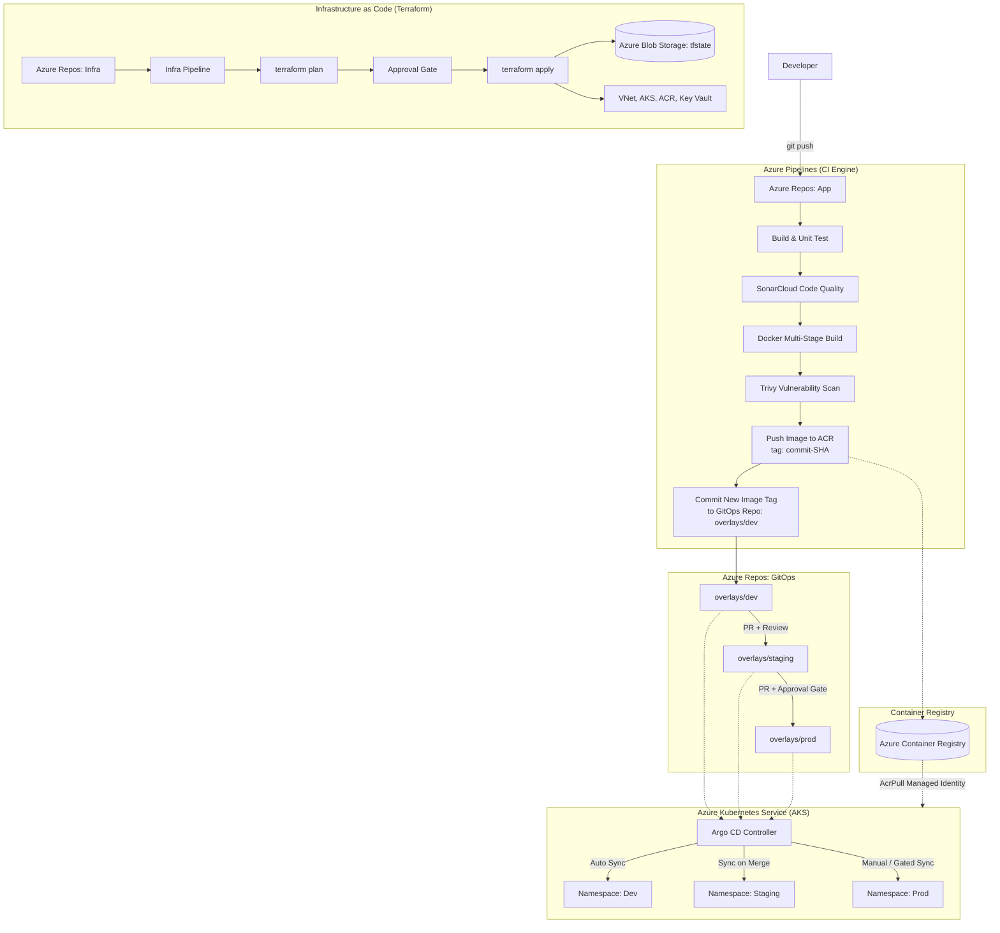

# 🚀 Real-World DevOps Project: Azure DevOps + GitOps + IaC

> **Automated Multi-Environment Deployment using Azure DevOps, GitOps (Argo CD), and Infrastructure as Code (Terraform)**

[](https://azure.microsoft.com/)
[](https://www.terraform.io/)
[](https://azure.microsoft.com/en-us/products/kubernetes-service)
[](https://argoproj.github.io/cd/)
[](https://azure.microsoft.com/en-us/products/devops/pipelines)
[](https://trivy.dev/)

---

## 📌 Table of Contents
- [Project Overview](#-project-overview)
- [Architecture & End-to-End Workflow](#-architecture--end-to-end-workflow)
- [Key Principles](#-key-principles)
- [Technology Stack](#-technology-stack)
- [Environment Promotion Strategy](#-environment-promotion-strategy)
- [Repository Strategy](#-repository-strategy)
- [10-Day Implementation Plan](#-10-day-implementation-plan)
- [Project Documentation Guide](#-project-documentation-guide)

---

## 📖 Project Overview

Traditional software deployments often suffer from manual execution, configuration drift across environments, slow release cycles, and elevated security risks.

This project delivers an enterprise-grade delivery platform where:
- **Infrastructure is Code (IaC):** All cloud resources are provisioned deterministically with reusable **Terraform** modules.
- **Continuous Integration (CI):** Applications are built, unit-tested, quality-inspected (SonarCloud), and security-scanned (Trivy) via **Azure Pipelines**.
- **GitOps Continuous Delivery (CD):** Deployments are driven from Git using **Argo CD**, establishing Git as the single source of truth for both infrastructure and cluster application state.

---

## 🏗️ Architecture & End-to-End Workflow



---

## 🔑 Key Principles

1. **Pull-Based Deployment:** Argo CD runs inside AKS and pulls manifests from Git. The CI pipeline never requires cluster admin credentials.
2. **Single Source of Truth:** Any change to infrastructure or application manifests must go through Git.
3. **Immutable Artifacts:** Images are tagged uniquely with commit SHAs (`never 'latest'`), ensuring determinism and verifiable auditability.
4. **Environment Parity:** The exact same image artifact moves through `dev -> staging -> prod`; environment-specific parameters are handled purely via **Kustomize overlays**.
5. **Self-Healing & Drift Detection:** Argo CD continuously monitors real-time cluster state against Git manifests and automatically reconciles unauthorized manual changes.

---

## 🛠️ Technology Stack

| Layer | Tool / Technology | Purpose |
|---|---|---|
| **Cloud Provider** | Microsoft Azure | Infrastructure host (VNet, AKS, ACR, Key Vault) |
| **Source Control** | Azure Repos / GitHub | Version control, PRs, and branch protection policies |
| **IaC** | Terraform (1.5+) | Modular resource provisioning with remote state locking |
| **CI Engine** | Azure Pipelines (YAML) | Automated build, test, scan, and GitOps manifest updates |
| **Containerization** | Docker | Multi-stage, minimal attack-surface container builds |
| **Container Registry**| Azure Container Registry (ACR) | Secure container image storage with managed identities |
| **Orchestration** | Azure Kubernetes Service (AKS) | Scalable managed Kubernetes cluster |
| **GitOps CD** | Argo CD + Kustomize | Declarative multi-environment sync and drift correction |
| **Secrets Management**| Azure Key Vault + CSI Driver | Zero hardcoded secrets, pod-level secret mounting |
| **Code & Container Scan** | SonarCloud & Trivy | Code smell detection and container CVE scanning |
| **Observability** | Prometheus & Grafana | Cluster metrics, dashboard visualization, and alerts |

---

## 🚦 Environment Promotion Strategy

| Environment | Trigger | Approval Gate | Sync Policy |
|---|---|---|---|
| **Development (`dev`)** | Automatic after CI success | None | Auto-sync, prune, self-heal enabled |
| **Staging (`staging`)** | Pull Request from dev overlay | 1 reviewer + automated checks | Auto-sync upon PR merge |
| **Production (`prod`)** | Pull Request from staging overlay | 2 reviewers + change approval gate | Manual sync / gated sync after PR merge |

---

## 📁 Repository Strategy

To maintain strict separation of concerns, the architecture utilizes three decoupled repository structures:

```text
├── app/                        # Application Source Code
│   ├── src/                    # Source code files
│   ├── tests/                  # Unit and integration tests
│   ├── Dockerfile              # Multi-stage container definition
│   ├── azure-pipelines.yml     # CI Pipeline configuration
│   └── sonar-project.properties
│
├── infra/                      # Infrastructure as Code
│   ├── modules/                # Reusable Terraform modules
│   │   ├── network/            # VNet, Subnets, NSGs
│   │   ├── acr/                # Container registry
│   │   ├── aks/                # Managed Kubernetes cluster
│   │   └── keyvault/           # Key Vault & access policies
│   ├── envs/                   # Environment-specific tfvars
│   │   ├── dev.tfvars
│   │   ├── staging.tfvars
│   │   └── prod.tfvars
│   ├── main.tf, variables.tf, backend.tf, outputs.tf
│   └── infra-pipeline.yml      # IaC validation & apply pipeline
│
└── gitops/                     # Deployment Manifests
    ├── base/                   # Base Kubernetes resources
    │   ├── deployment.yaml
    │   ├── service.yaml
    │   └── kustomization.yaml
    ├── overlays/               # Environment-specific overrides
    │   ├── dev/kustomization.yaml
    │   ├── staging/kustomization.yaml
    │   └── prod/kustomization.yaml
    └── argocd-apps/            # Argo CD Application definitions
        ├── dev-app.yaml
        ├── staging-app.yaml
        └── prod-app.yaml
```

---

## 📅 10-Day Implementation Plan

- **Day 1: Foundation & Setup** — Azure subscription, DevOps org, Git repos, prerequisite tooling verification.
- **Day 2: Application & Dockerization** — Multi-stage Dockerfile, local testing, unit tests.
- **Day 3: Terraform Foundation** — Remote state storage backend, networking module, Azure Container Registry.
- **Day 4: AKS & Key Vault** — AKS cluster provisioning, Key Vault integration, environment variable definitions.
- **Day 5: Infrastructure Pipeline** — Azure DevOps pipeline for Terraform plan/apply with manual approval gates.
- **Day 6: Continuous Integration** — Multi-stage CI pipeline with SonarCloud analysis and Trivy image scanning.
- **Day 7: GitOps Foundation** — Argo CD setup on AKS, base manifests, and Kustomize overlays.
- **Day 8: Continuous Delivery & Promotion** — Automated CI-to-GitOps commit flow and PR-based staging/prod promotion.
- **Day 9: Security Hardening & Observability** — Key Vault CSI driver, RBAC policies, Prometheus & Grafana monitoring.
- **Day 10: Validation, Polish & Testing** — End-to-end commit-to-deployment verification, disaster recovery/rollback testing.

---

## 📄 Project Documentation Guide

The complete 18-page comprehensive project manual, architecture breakdowns, interview guides, and code samples are included in this repository:

👉 **[Download / View Project Guide PDF](Azure_DevOps_GitOps_IaC_Project_Guide.pdf)**

---

## 👤 Author & Maintainer
- **Vishesh** ([@vishesh-i-tech](https://github.com/vishesh-i-tech))
